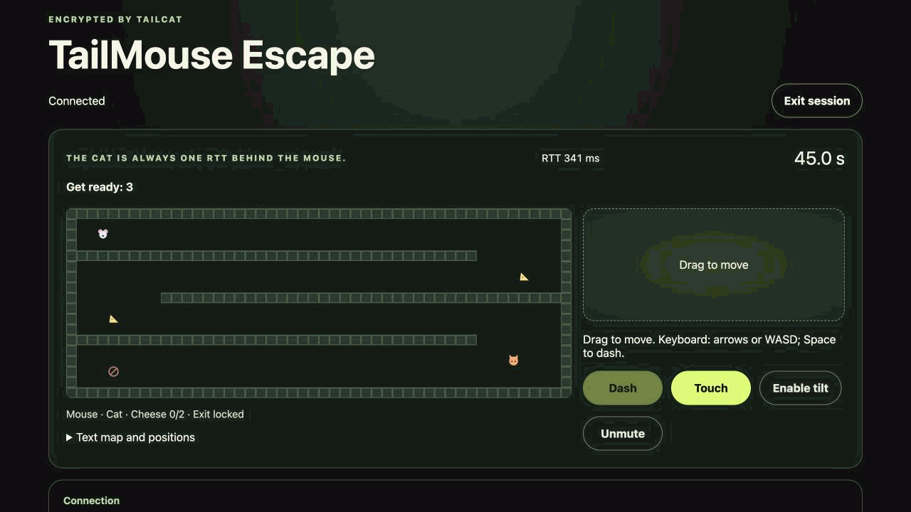
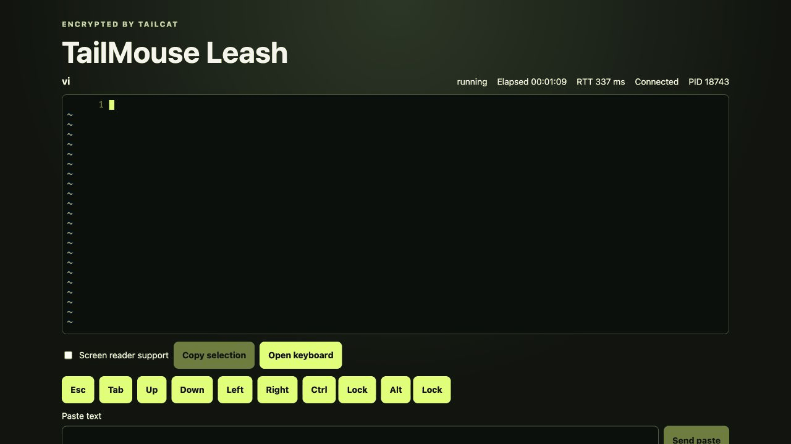

# TailMouse

A small native CLI and a mobile-first browser client for two kinds of temporary session:

## Escape demo

Steer the mouse, dash, and avoid the cat following your RTT-delayed scent trail. The browser predicts your movement locally; the host decides the outcome.



## Leash demo

Control one explicitly launched terminal application from a browser. Interactive shells and full-screen TUIs use a real PTY, not screenshots.



These 18.6-second Escape and 16.18-second Vim recordings use the built browser client and a native macOS host over official Tailcat DERP. They demonstrate working flows, not completed release or physical-mobile acceptance.

TailMouse is an **unofficial** application built on [Tailcat](https://github.com/tailscale/tailcat). The host needs only the `tailmouse` executable; it embeds Tailcat's Go library. The browser loads the same dependency revision as Wasm. Users do not separately install the Tailcat CLI or join a Tailscale account. Browser transport is currently **DERP-only**; there is no browser direct-UDP or WebRTC upgrade. Leash does **not** stream native GUI windows or desktops.

TailMouse is not affiliated with or endorsed by Tailscale Inc. Tailscale and Tailcat names and trademarks belong to their respective owners.

**Treat every invitation link and QR code like a password.** The current version has no separate password prompt: the full invitation is the access credential. Anyone holding it can attempt access until expiry or host revocation. A writable terminal has the launched process's authority. DERP sees connection metadata, timing and traffic sizes, although session payloads are end-to-end encrypted. The Web page is a trusted endpoint and can see session plaintext.

## Development status

This checkout is not a release-ready v0.1. macOS has native/browser integration evidence; Linux builds and portable tests are not full native acceptance. Windows archives compile, but Windows Leash composition is still unavailable. Unix termination of separate shell job groups is incomplete. Do not rely on restart, terminate or kill-on-expiry/disconnect to contain a complete process tree yet; use disposable test commands, not important unattended tasks.

The release target is macOS 13+, Linux glibc distributions and Windows 11, each on amd64/arm64. Browser targets are the latest two major Safari, Chrome, Edge and Firefox versions, with iPhone Safari and Android Chrome as mobile acceptance targets. Automated browser profiles do not establish physical-device support. See the [conformance ledger](docs/evidence/prd-conformance.md) for current evidence and remaining work, including process-tree, platform and final release acceptance. No hosted TailMouse service, Homebrew tap or published release is claimed here.

## Build and try locally

Use the exact Node, pnpm and Go versions in [tooling/versions.json](tooling/versions.json), with Corepack available. From this checkout:

```sh
git submodule update --init -- third_party/tailcat
corepack pnpm install --frozen-lockfile
corepack pnpm exec node tools/tailcat-gate.mjs build
corepack pnpm build
```

Native output is `.artifacts/native/tailmouse` (`tailmouse.exe` on Windows); static Web output is `apps/web/dist/`. The build verifies the initialized Tailcat checkout against the recorded gitlink. Do not copy in a separately downloaded Wasm or update the submodule implicitly.

In each macOS/Linux terminal used below, add the built CLI to PATH:

```sh
export PATH="$PWD/.artifacts/native:$PATH"
tailmouse version
```

Serve the built Web client for a browser on this same computer:

```sh
corepack pnpm --filter @tailmouse/web exec vite preview --host 127.0.0.1 --port 4173 --strictPort
```

Leave that terminal running. In another terminal at the repository root, start either example:

```sh
tailmouse escape --web-base-url http://127.0.0.1:4173/
tailmouse leash --web-base-url http://127.0.0.1:4173/ -- vim
```

The second example requires Vim on the host. Open the invitation printed by the CLI in your browser. Leash's default `connect-or-enter` policy waits for a valid browser connection or local Enter before starting the saved command.

The loopback URL is only for a browser on the host computer: `127.0.0.1` on a phone means the phone itself. For a phone, deploy the same static files to a trusted reachable HTTPS origin, set `--web-base-url` or `TAILMOUSE_WEB_BASE_URL` to that origin, then scan the new QR code. The default `https://tailmouse.dev/` is the PRD placeholder, not a verified deployment. The [self-hosting guide](docs/web-self-hosting.md) covers HTTPS, Nginx, MIME types, compression, cache updates and non-root mounts. Vite preview is a local verification server, not the production hosting configuration.

## Escape

```sh
tailmouse escape --web-base-url http://127.0.0.1:4173/ --control touch --map courtyard --seed 42 --round 45s
tailmouse escape --web-base-url http://127.0.0.1:4173/ --control tilt --once=false
```

Collect both cheeses, then reach the unlocked exit before capture or timeout. Use the touch joystick and Dash control; tilt is an explicit optional action with permission and calibration, and touch remains available after refusal. The browser shows RTT, connection state and dash cooldown. The host decides collisions and results.

The terminal shows the spectator map and scent trail. `q` or Ctrl+C closes Escape; after a result, `r` starts another round when `--once=false` and the session has not expired. `d` toggles debug details. Defaults are a 45-second round and a 10-minute session TTL. A temporary connection loss slows/stops movement, then pauses the round; reconnect has a 30-second grace window.

## Leash

On macOS, launch an interactive zsh:

```sh
tailmouse leash --web-base-url http://127.0.0.1:4173/ -- /bin/zsh -i
```

Or launch Vim and other terminal commands with their own arguments:

```sh
tailmouse leash --web-base-url http://127.0.0.1:4173/ --readonly --start-on now -- vim
tailmouse leash --web-base-url http://127.0.0.1:4173/ --title demo --no-restart --no-terminate --post-exit-ttl 0 -- printf hello
```

Arguments after `--` are passed literally to the launched program, not interpreted as TailMouse flags. When switching programs, replace their arguments too: Vim's `-u NONE -U NONE -i NONE -n` options must not be passed to zsh. Use `/bin/zsh -f -i` to test without personal shell startup configuration. Pipes, redirects, wildcards and variables require an explicitly launched shell; TailMouse does not interpret them. Restart reuses the original argv, working directory and environment rather than accepting a replacement command from the browser.

The browser provides a terminal, touch history scrolling, Esc/Tab/arrows, Ctrl/Alt modifiers and explicit copy/paste. Readonly hides input and process controls and is enforced by the host, but it does not redact sensitive output. Enable Screen reader support explicitly if needed. Browser Backpressure pauses input; use the displayed recovery action, and do not assume already-sent input can be safely retried.

Browser disconnect normally leaves the child running. Within reconnect grace, the same live page can retry explicitly and receive retained scrollback. The default raw-byte scrollback is 1 MiB (configurable from 64 KiB to 16 MiB); older bytes may be dropped with an indication. This is bounded history, not a terminal recording.

The session TTL defaults to four hours. After child exit, the final output/status remains available for up to ten minutes, bounded by the session TTL; `--post-exit-ttl 0` ends retention immediately. Expiry revokes browser access but does not kill the child by default. `--kill-on-expire` and `--kill-on-disconnect` explicitly request termination and remain subject to the process-tree limitation above.

While a child runs, the first local Ctrl+C interrupts it; a second within two seconds requests host and child shutdown. Ordinary `q` remains application input. Browser interrupt/restart/terminate require confirmation and the host's permission. These controls are not a security sandbox or a replacement for OS process isolation.

## Configuration and relays

```sh
tailmouse config path
tailmouse --help
tailmouse escape --help
tailmouse leash --help
```

Settings resolve per field as **flags > environment > version-1 TOML > defaults**. Boolean flags can be disabled with `--flag=false`. See [configuration](docs/configuration.md) for the complete TOML schema, environment selectors, defaults and exit codes.

With no relay override, Tailcat selects from its official relay map. The static Web host serves application files; DERP carries the encrypted connection. Self-hosting the Web files does not create a relay, and using a custom DERP does not host the Web application. Virtual port 44321 is inside Tailcat's userspace network, not a public terminal service to port-forward.

To use an operator-managed relay, follow [custom DERP requirements](docs/custom-derp.md). Hostname mode and HTTPS map mode are mutually exclusive; the selected region is embedded in the invitation, so the browser needs no separate map configuration.

## Security and troubleshooting

- Share invitations privately. Keep them out of issue reports, screenshots, terminal recordings, browser diagnostics and shell arguments. `--no-qr` hides the QR, not the remaining `Open:` URL.
- One active browser is not identity authentication: another link holder can race during reconnect. Use a short TTL; `--ttl 0` retains access until host exit/mode completion and increases exposure.
- The page consumes the fragment and removes it from visible history. Credentials are memory-only: after reload, reopen an unexpired original invitation. Caching static Wasm does not preserve a session or make relay connectivity optional.
- A trusted Web deployment matters. There are no required third-party scripts or analytics, but a modified page or browser extension can still expose terminal data. Verify matching Native/Web revision metadata and use the documented HTTPS/security headers.
- `SESSION_BUSY` means another browser owns the slot. `EXPIRED` needs a fresh host session. A protocol mismatch needs compatible Native and Web builds, not repeated retries.
- For a loading failure, check that the static server returns real local JS/Wasm files with the correct MIME and compression headers, not an HTML fallback. Browser permissions or a failed static cache registration do not authorize more capabilities.
- For relay failure, check DNS, public TLS, reachability and the custom-relay restrictions. TailMouse does not provide a production TLS-verification bypass. Capture only redacted error codes and version information.
- Missing clipboard or tilt permission retains the manual paste/touch path. IME/Unicode input uses xterm's native input handling; virtual modifiers apply to keys, not terminal device replies or composed text.
- A GUI-launching command can create a local native window, but Leash shows only its PTY bytes and process state. No desktop, camera or microphone is streamed.

TailMouse does not provide anonymity, file transfer, SSH, a hosted account/control plane or unattended remote administration. Tailcat owns encryption and transport; TailMouse owns session permissions, protocol and the two modes. See [Tailcat's transport description](https://github.com/tailscale/tailcat#readme) for the upstream boundary.

## Development and release checks

```sh
corepack pnpm gate:quick
corepack pnpm gate
corepack pnpm tailcat:check
corepack pnpm release:snapshot
```

Install the matching Playwright browsers before browser tests. `gate:quick` is the iteration gate; `gate` additionally runs race, vulnerability and the complete real Go/Wasm impairment suite. Both stop at the first required failure. TypeScript statements/branches/functions/lines and Go statements each retain their configured 80% floor.

`release:snapshot` additionally requires the pinned GoReleaser executable. It creates local six-platform archives and checks identity without signing, deleting prior output or publishing. Local per-artifact SBOM, checksum and source-notice verification are also available. Snapshots are not approved releases. See [gates and snapshot builds](docs/development/gates.md) for prerequisites and the separate release/platform acceptance requirements.

## License

TailMouse-owned source is licensed under [Apache-2.0](LICENSE), with project attribution in [NOTICE](NOTICE). [Third-party notices](THIRD_PARTY_NOTICES.txt) preserve the original licenses and attribution, including the read-only Tailcat submodule. All three files accompany native and static Web distributions. The [source inventory](tooling/third-party-licenses.json) records versions and original-file hashes; `pnpm check:licenses` rejects drift after the build. Dependency changes require reviewing and explicitly updating notices with `pnpm release:notices`.

The repository keeps two application boundaries (`apps/cli`, `apps/web`), language-neutral contracts under `protocol`, and system tests under `tests`. Start with [architecture](docs/architecture.md), [SDD](docs/development/sdd.md), [Tailcat ownership](docs/development/tailcat-submodule.md), [the constitution](docs/governance/constitution.md) and the [product baseline](docs/product-baseline.md). Tailcat source and its recorded gitlink are read-only unless an update is explicitly requested.
