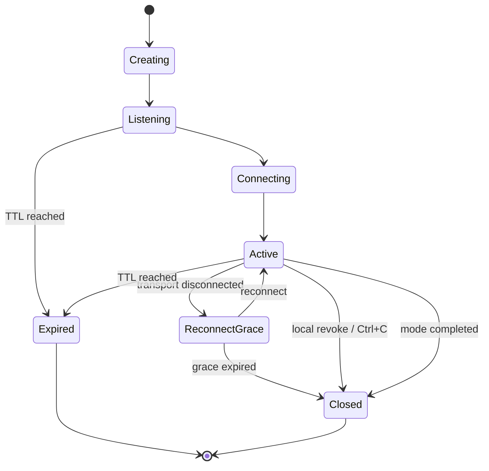
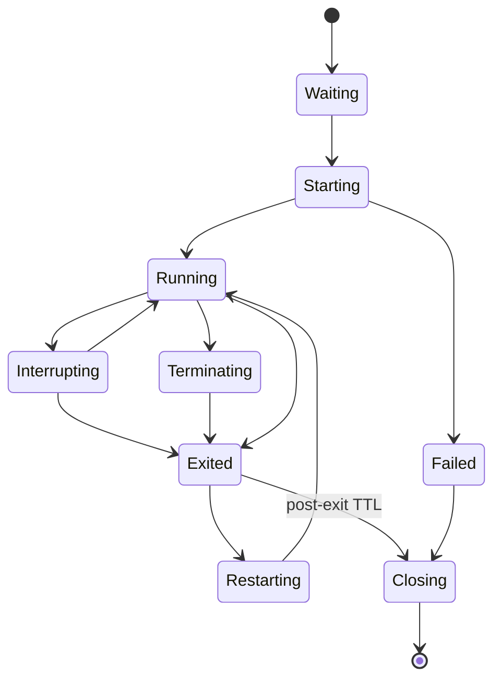

# TailMouse PRD v1.0

> **定位：一个建立在 Tailcat 之上的趣味浏览器会话工具。首版只做一个游戏 `escape`，以及一个真正有用的终端进程远程控制工具 `leash`。**
>
> **Slogan：** *Tailcat opens the tunnel. TailMouse puts it to work.*
>
> 文档状态：可开发  
> 文档版本：v1.0  
> 基线日期：2026-09-01  
> 补充确认：2026-09-03（§7.4：30 秒无有效 PONG 的失联判定）  
> Tailcat 依赖基线：v0.4.0（必须固定版本或 commit，不跟随 `main` 浮动）  
> 项目属性：非商业、开源、非官方社区伴生项目  
> 建议许可证：BSD-3-Clause 或 Apache-2.0  
> 首发平台：macOS、Linux、Windows；浏览器端为移动端优先的静态 PWA

---

## 0. 已确定的产品决策

以下决策在 v0.1 中不再讨论：

1. TailMouse 不重新实现 WireGuard、NAT 穿透、DERP、Netstack 或 Tailcat wire format。
2. Native 端直接嵌入 Tailcat Go library；用户只安装 `tailmouse`，不要求另装 `tailcat`。
3. 浏览器端复用 Tailcat 的 Go/Wasm transport；另一端只需扫码打开网页，不安装 App、TailMouse、Tailcat 或 Tailscale。
4. 默认使用 Tailcat 官方托管 relay map：`https://tailcat.dev/derpmap.json`。
5. 用户可以通过 CLI、环境变量或 TOML 配置自建 DERP hostname，或自定义 DERP map URL。
6. Native 端生成的 Tailcat ConnBlob 必须嵌入完整 DERP region，使浏览器无需额外获取 DERP map。
7. 首版只提供两个一级功能：
   - `tailmouse escape`：真实网络延迟参与玩法的猫鼠小游戏。
   - `tailmouse leash -- <command>`：通过手机浏览器查看和控制一个真实 PTY/TUI 终端进程。
8. `leash` 支持 Codex CLI、vim、htop、lazygit、交互式安装器等终端程序；不支持 macOS/Windows/Linux 原生 GUI 窗口画面。
9. 不建设账号系统、数据库、中心控制面、短码服务或自有业务 relay。
10. TailMouse Web 必须完全静态、可自托管、无 analytics、无第三方脚本。
11. Tailcat v0.x 当前不承诺 Go API、CLI 和 wire format 稳定，因此所有 Tailcat 依赖必须隔离在 transport adapter 中。
12. v0.1 不做摄像头、麦克风、远程桌面、文件管理、浏览器 SSH、HTTP Tunnel 或完整手机远程鼠标。

---

# 1. 背景与技术基线

## 1.1 Tailcat 已经解决的问题

Tailcat 是一个使用 Tailscale 开源数据面的无控制面临时连接工具。其主要能力包括：

- 用户态 WireGuard 端到端加密；
- magicsock 端点发现与 NAT traversal；
- DERP 作为连接引导与直连失败后的中继；
- gVisor Netstack 在进程内处理虚拟 TCP；
- 不要求 Tailscale 账号、tailnet、root 权限、系统路由或 DNS 修改；
- 通过 `tc...` ConnBlob 带外分发连接元数据；
- 原生端之间尽可能升级为直接 UDP 路径；
- Tailcat 浏览器 Wasm 当前只能通过 DERP WebSocket，不能升级为直接路径。

Tailcat v0.4.0 已经包含原始字节流、端口转发、SSH、SFTP/文件、SOCKS、exit node、客户端公钥 allowlist、持久密钥和浏览器 Wasm 示例。因此 TailMouse 不应重复这些底层功能。

## 1.2 TailMouse 补充的问题

Tailcat 的抽象是：

```text
ConnBlob → 加密连接 → 虚拟 TCP 字节流
```

TailMouse 的抽象是：

```text
ConnBlob + MouseCard → 自描述的一次性浏览器会话
```

TailMouse 负责：

- 为连接赋予应用语义：`escape` 或 `leash`；
- 生成手机可扫描的二维码和链接；
- 提供移动端 UI；
- 定义会话生命周期、权限、状态和错误语义；
- 将浏览器触摸输入映射为游戏控制；
- 将 Native PTY 映射为浏览器终端；
- 对 Tailcat 官方 DERP 与自建 DERP 做一致配置；
- 展示真实 RTT、jitter、relay hostname 和连接状态。

## 1.3 TailMouse 不是什么

TailMouse 不是：

- Tailcat 的 fork；
- Tailcat GUI；
- Tailscale 客户端；
- 远程桌面；
- ngrok/Cloudflare Tunnel 替代品；
- 手机远程鼠标 App；
- 浏览器 SSH 网关；
- 账号化 SaaS；
- 匿名通信工具。

---

# 2. 产品目标与非目标

## 2.1 产品目标

### G1：一条命令、一张二维码、浏览器即用

```bash
tailmouse escape
tailmouse leash -- codex
```

命令启动后必须在终端直接展示：

- 二维码；
- 可复制 URL；
- 会话模式；
- 过期时间；
- DERP 模式与 hostname/region；
- 安全提示。

### G2：游戏具有传播性，而非仅做 Echo Demo

`escape` 必须把 Tailcat 浏览器链路的 RTT 和 jitter 显式变成游戏机制和视觉元素。README 中一张 10～20 秒 GIF 应能解释项目。

### G3：工具具有真实使用价值

`leash` 必须能够：

- 启动真实 PTY；
- 正确呈现 ANSI、光标、全屏 TUI；
- 远程输入；
- 远程 resize；
- 发送 Interrupt；
- Terminate；
- Restart 同一命令；
- 浏览器断开后进程继续运行；
- 重连后补发有限滚动缓冲。

### G4：默认零基础设施，自建 DERP 可选

无配置时使用 Tailcat 官方 relay map。用户只在需要更低延迟、自主管理 relay 或特定区域时配置自建 DERP。

### G5：可维护、可上游跟进

Tailcat 不稳定 API 必须被单独 adapter 包裹。核心业务协议和 UI 不得依赖 Tailcat 内部类型。

## 2.2 非目标

v0.1 明确不做：

- Native GUI 窗口捕获与控制；
- 完整桌面画面传输；
- 摄像头、麦克风、视频流；
- 多人房间；
- 账号、SSO、ACL 控制台；
- 连接历史云存储；
- 会话录像；
- 自建中心 rendezvous；
- 自有短链接；
- 自有中继协议；
- 浏览器端直接监听 OS localhost 端口；
- Tailcat 原生客户端的 P2P/WebRTC 重写；
- 长期 daemon；
- 无人值守远控。

---

# 3. 用户与核心使用场景

## 3.1 用户画像

主要用户：

- 喜欢 Tailscale/Tailcat、终端工具和趣味开源项目的开发者；
- 经常运行构建、测试、Agent、安装器或其他终端任务的开发者；
- 想用手机快速演示网络连接、传感器和终端交互的人；
- 希望使用自建香港、台北、新加坡等 DERP 减少浏览器路径延迟的高级用户。

## 3.2 核心场景 A：试玩

```text
用户在电脑运行 tailmouse escape
→ 终端显示 QR
→ 手机扫码
→ 手机浏览器出现触控摇杆和游戏画面
→ 终端显示观众视角
→ 老鼠留下由真实 RTT 决定长度的气味轨迹
→ 猫追逐延迟轨迹
→ 结束画面显示 RTT、jitter 和 DERP
```

## 3.3 核心场景 B：看守 Codex 或其他 TUI

```text
用户运行 tailmouse leash -- codex
→ 终端显示 QR，等待浏览器连接或本地 Enter
→ 手机扫码
→ Codex 在 PTY 中启动
→ 手机显示真实终端 UI
→ 用户可输入、查看 diff、响应审批、Ctrl-C
→ 浏览器切后台或断网时 Codex 继续运行
→ 浏览器重连后补发最近输出
```

## 3.4 核心场景 C：自建 DERP

```text
用户已有 derp.example.com
→ 配置 tailmouse.toml 或传 --derp-host
→ TailMouse 在 Native 端构造自定义 DERP region
→ Tailcat ConnBlob 嵌入 hostname
→ QR 中只携带 MouseCard + ConnBlob
→ 浏览器无需另配 DERP map，直接连自建 DERP
```

---

# 4. 产品形态

## 4.1 Native CLI

一个单文件二进制：

```text
tailmouse
```

一级命令：

```bash
tailmouse escape
tailmouse leash -- <command> [args...]
tailmouse version
tailmouse config path
```

辅助诊断命令放入 P1，不属于首发核心功能：

```bash
tailmouse doctor
```

## 4.2 Browser PWA

单一静态 Web 应用，根据 MouseCard 中的 `mode` 加载页面：

```text
/#/v1/<base64url-cbor-mouse-card>
```

支持：

- 移动端 Safari、Chrome；
- 桌面 Chrome、Firefox、Safari、Edge；
- PWA 静态缓存；
- 无登录；
- 无后端 API；
- 无第三方 JS；
- 不把 ConnBlob 发送给静态站点服务器。

## 4.3 数据路径

```text
┌──────────────────────────────┐
│ Native: tailmouse            │
│                              │
│ escape engine / PTY          │
│ TMOUSE/1                     │
│ Tailcat Server (Go library)  │
└──────────────┬───────────────┘
               │
        WireGuard over DERP
        Browser 当前无直连
               │
┌──────────────▼───────────────┐
│ Browser PWA                  │
│                              │
│ Tailcat Go/Wasm              │
│ TMOUSE/1                     │
│ Canvas / xterm.js            │
└──────────────────────────────┘
```

---

# 5. 全局 CLI 规范

## 5.1 命令帮助

```text
tailmouse — tiny browser sessions over Tailcat

Usage:
  tailmouse escape [flags]
  tailmouse leash [flags] -- <command> [args...]
  tailmouse version
  tailmouse config path

Global flags:
  --config <path>
  --web-base-url <https-url>
  --derp-host <host[,host...]>
  --derp-map-url <https-url>
  --ttl <duration>
  --once
  --no-qr
  --json
  --quiet
  --verbose
  --squeak
```

`--squeak` 是 `--verbose` 的趣味别名，不能替代标准参数。

## 5.2 配置优先级

从高到低：

```text
CLI flag
> 环境变量
> config.toml
> 内置默认值
```

## 5.3 环境变量

```text
TAILMOUSE_CONFIG
TAILMOUSE_WEB_BASE_URL
TAILMOUSE_DERP_HOST
TAILMOUSE_DERP_MAP_URL
TAILMOUSE_TTL
TAILMOUSE_NO_QR
TAILMOUSE_LOG
```

`TAILMOUSE_DERP_HOST` 与 `TAILMOUSE_DERP_MAP_URL` 互斥。

## 5.4 退出码

| 退出码 | 含义 |
|---:|---|
| 0 | 正常完成，或 `escape` 正常退出 |
| 2 | CLI 参数/配置错误 |
| 3 | Web URL 或 MouseCard 生成失败 |
| 4 | DERP/Tailcat 初始化失败 |
| 5 | 浏览器会话协议错误 |
| 6 | PTY/ConPTY 初始化失败 |
| 7 | 子进程启动失败 |
| 8 | 会话过期或被本机撤销 |
| 125 | TailMouse 内部错误 |
| 126 | 命令不可执行 |
| 127 | 命令不存在 |
| 其他 | `leash` 最后一次子进程的退出码 |

若 `leash` 因 TailMouse 自身失败而退出，不得伪装成子进程退出码。

---

# 6. 邀请链接与 MouseCard

## 6.1 URL 格式

```text
https://tailmouse.example/#/v1/<base64url(CBOR(MouseCard))>
```

规则：

- ConnBlob 只能出现在 URL fragment 中；
- 禁止放在 query string；
- 页面加载后立即解析并写入 `sessionStorage`；
- 随后调用 `history.replaceState` 从地址栏移除敏感 payload；
- 刷新时从当前 tab 的 `sessionStorage` 恢复；
- tab 关闭后自动消失；
- 禁止写入 `localStorage`、IndexedDB、analytics 或错误上报。

## 6.2 MouseCard 结构

```go
type MouseCard struct {
    Version      uint8  // 1
    Mode         string // "escape" | "leash"
    TailcatAddr  string // full self-contained ConnBlob
    Port         uint16 // TMOUSE/1 virtual TCP port
    SessionID    [16]byte
    ExpiresAt    int64  // Unix seconds
    ProtocolMin  uint16 // 1
    ProtocolMax  uint16 // 1
}
```

CBOR 推荐字段：

```text
v  version
m  mode
t  tailcat addr
p  port
s  session id
e  expires at
a  protocol min
z  protocol max
```

约束：

- MouseCard 不包含命令、cwd、环境变量、用户名或日志；
- Browser 连接后从 Host 的 `WELCOME/MANIFEST` 获取权威信息；
- MouseCard 中的 mode 只用于选择初始 UI，不是权限来源；
- Host 必须校验 SessionID、mode 和 protocol version；
- v0.1 不给 MouseCard 再做签名。权限由 Host 强制，Tailcat ConnBlob 本身是 bearer capability；
- 编码后链接目标长度小于 1400 字节；
- QR 使用 error correction M，终端显示至少 33×33 可见模块，四周保留 quiet zone。

## 6.3 默认 Web Base URL

发布前替换为真实域名。开发环境：

```text
http://localhost:5173/
```

正式环境建议：

```text
https://tailmouse.dev/
```

用户可配置自托管静态页面：

```bash
tailmouse escape --web-base-url https://mouse.example.com/
```

---

# 7. 会话生命周期

## 7.1 通用状态机



## 7.2 默认 TTL

| 模式 | 默认 TTL |
|---|---:|
| `escape` | 10 分钟 |
| `leash` | 4 小时 |
| `leash` 子进程退出后的保留期 | 10 分钟 |
| 重连宽限 | 30 秒 |

`--ttl 0` 表示直到 Host 退出或模式完成，不推荐用于公开分享。

## 7.3 单客户端规则

v0.1 默认一个活动浏览器：

- 第一个完成 `HELLO` 的连接占用 session；
- 第二个活动连接收到 `SESSION_BUSY`；
- 原连接断开后进入 reconnect grace；
- grace 内允许一个新连接接管；
- 因链接本身是 bearer capability，重连不提供强设备身份保证；
- v0.1 不承诺抵抗“链接泄露后抢占连接”，README 必须明确。

## 7.4 半开连接与心跳失联判定

**2026-09-03 用户确认补充：** 浏览器崩溃或网络中断后，底层连接可能未立即报告断开，不能因此长期占用唯一活动连接名额。

- Host 复用现有每秒一次的 `PING/PONG`，对已完成握手的活动连接进行存活检测。
- 从握手成功开始计时；收到与该连接未完成 `PING` 的 sequence、timestamp 相匹配的有效 `PONG` 后，重置失联计时。使用 Host 本地单调时钟，不依赖浏览器时钟同步。
- 连续 **30 秒未收到有效 `PONG`**，Host 判定旧连接失联，关闭该连接、取消其连接级工作并释放活动名额，随后进入现有 reconnect grace 流程；不等待底层 TCP 自行超时。
- 重复、过期、不匹配的 `PONG`、普通业务数据或其他连接的消息，均不得刷新旧连接的失联计时。
- 失联检测的 30 秒与断开后默认 30 秒的重连宽限是两个不同阶段；不修改原始分享 TTL，不延长已有的过期或模式结束期限。
- `leash` 默认保留同一子进程、PTY 和有界 scrollback，本机终端继续可用；重连不得自动重启子进程。显式设置的 `--kill-on-disconnect` 仍按既有规则生效。
- 新连接仍需完成邀请与协议校验并竞争唯一活动名额；旧连接尚未失联时仍返回 `SESSION_BUSY`。`escape` 的输入衰减、暂停和结束规则保持不变。

验收补充：

- 强制结束真实浏览器进程，不发送正常关闭消息；确认旧名额在失联判定后释放，新浏览器可在重连宽限内恢复同一运行中的 Leash 子进程及其历史/实时输出。
- 正常有效 `PONG` 持续刷新存活时间；重复、过期、不匹配 `PONG` 不能延长连接寿命，30 秒边界前不提前判定失联。
- 分别验证默认子进程存活与显式 `--kill-on-disconnect`，并确认旧连接排队输入不会在重连后重放。

---

# 8. Feature A：`tailmouse escape`

## 8.1 产品定义

一个 30～45 秒的双屏猫鼠追逐游戏：

- 手机浏览器是玩家主画面与控制器；
- Native 终端是观众视角和网络 HUD；
- Host 维护权威游戏状态；
- Browser 进行本地预测；
- 猫追逐由真实 RTT 形成的“气味轨迹”；
- 网络延迟不是隐藏缺陷，而是游戏主题。

核心文案：

> **The cat is always one RTT behind the mouse.**

## 8.2 CLI

```bash
tailmouse escape [flags]
```

模式参数：

```text
--control touch|tilt        默认 touch
--ttl 10m
--once=true
--seed <int64>
--map <name|random>         默认 random
--round 45s
--phone-render=true
--terminal-render=true
--show-net=true
```

## 8.3 启动界面

```text
┌────────────────────────────────────────────────────┐
│ TAILMOUSE ESCAPE                                   │
│                                                    │
│ Scan the mouse hole                                │
│                                                    │
│            [ terminal QR code ]                    │
│                                                    │
│ Mode       escape                                  │
│ Relay      official / derp.example.com             │
│ Expires    9m59s                                   │
│                                                    │
│ Treat this link like a password.                   │
└────────────────────────────────────────────────────┘
```

## 8.4 游戏规则

MVP 固定规则：

- 地图：48×18 逻辑网格，位置使用浮点数；
- 地图来源：5 个预制可解地图，按 seed 选择；v0.1 不写随机迷宫生成器；
- 一只鼠；
- 一只猫；
- 两块奶酪；
- 一个初始锁定的出口；
- 收集两块奶酪后出口打开；
- 45 秒内进入出口则获胜；
- 猫与鼠中心距离小于 0.55 cell 判定捕获；
- 鼠拥有一个 Dash 技能；
- 不做攻击、道具商店、积分排行或多人模式。

建议参数：

```text
mouse_speed           6.0 cells/s
cat_base_speed        5.3 cells/s
cat_max_speed         6.2 cells/s
dash_multiplier       2.2
dash_duration         350ms
dash_cooldown         5s
round_duration        45s
countdown              3s
```

猫速度根据 RTT 轻微补偿：

```text
cat_speed = min(cat_max_speed, cat_base_speed + rtt_ms * 0.003)
```

这只是首版参数，必须可通过常量或开发配置调节。

## 8.5 气味轨迹

Host 每个 simulation tick 将鼠标位置写入时间序列：

```go
type ScentPoint struct {
    At time.Time
    X  float32
    Y  float32
}
```

猫的目标不是当前鼠标位置，而是：

```text
target_time = now - clamp(rtt_ewma, 40ms, 250ms)
```

从 scent buffer 中插值出该时刻的位置。

视觉：

```text
🐈  ·  ·  ·  ·  ·  🐁
```

- `·` 为气味点；
- RTT 越高，尾巴越长；
- jitter 高时气味点间距更不均；
- 高延迟不能让猫无限变弱，因此使用上面的速度补偿。

Display detail (2026-09-04): both views select dots from observed mouse-position history over twice the clamped delay, an 80-500 ms window. Alternating sample gaps are `50 ms +/- min(jitter / 2, 25 ms)`, quantized to available samples and terminal cells. Points are never randomly displaced; stationary motion does not fabricate a longer path. The terminal reuses its simulation history. The browser keeps at most 16 actually rendered positions, sampled no faster than 30 Hz; this visual prediction history is not authoritative state or a new wire payload. Browser history clears on a new round, pause/countdown/stop, a render gap above 100 ms, or a displayed jump above one cell. Cat pursuit, speed and outcomes are unchanged.

## 8.6 控制方式

### Touch，默认

手机画面底部为虚拟摇杆：

```text
touchstart → 记录中心
touchmove  → 计算归一化向量
touchend   → vx=0, vy=0
```

死区：0.08  
最大半径：屏幕短边的 18%  
向量长度映射为速度比例 0～1。

### Tilt，可选

- 必须由用户点击“Enable tilt”后请求浏览器权限；
- iOS 权限请求必须发生在用户手势中；
- 使用 beta/gamma；
- 启用时执行 1 秒校准；
- 默认滤波使用指数移动平均；
- 设备不支持或拒绝权限时自动退回 touch。

## 8.7 网络与模拟频率

```text
Host authoritative simulation     30 Hz
Browser local rendering           60 FPS
Browser input intent              20 Hz
Host world snapshot               10 Hz
Ping/Pong                         1 Hz
Terminal rendering                20 FPS
```

Browser 发送的是控制意图，不是每帧坐标：

```json
{
  "seq": 182,
  "client_time_ms": 1788238400123,
  "vx": 0.72,
  "vy": -0.31,
  "dash": false
}
```

连续输入采用 latest-only 队列：

```text
只允许一个 write 在途；
新的 MOVE 覆盖尚未发送的旧 MOVE；
DASH 等离散事件不得被覆盖。
```

## 8.8 本地预测与校正

Browser：

1. 收到触摸后立即更新本地鼠位置；
2. 不等待网络 round trip；
3. 收到 Host snapshot 后计算偏差；
4. 偏差 < 0.25 cell：100ms 内平滑插值；
5. 偏差 0.25～1.0 cell：200ms 内校正；
6. 偏差 > 1.0 cell：立即 snap，并播放“dust”视觉效果；
7. snapshot `server_seq` 小于等于已处理值时丢弃。

Host：

- 150ms 无输入：保持方向但开始速度衰减；
- 500ms 无输入：速度归零；
- 3s 无输入：暂停游戏并显示 connection lost；
- 30s 内重连：继续；
- 超过 grace：结束本局。

## 8.9 Browser 游戏 UI

```text
┌────────────────────────────┐
│ TAILMOUSE      RTT 48 ms   │
│                            │
│  #######                   │
│        #          🧀       │
│    🐁  #                   │
│        #####               │
│                     ○      │
│                🐈          │
│                            │
│       drag to move         │
│                            │
│        [  DASH  ]          │
└────────────────────────────┘
```

必须包含：

- 全局地图；
- 鼠、猫、奶酪、出口；
- Touch 控制区；
- Dash 按钮及冷却；
- RTT；
- 连接状态；
- touch/tilt 切换；
- 静音开关；
- 退出按钮。

## 8.10 Terminal 观众 UI

```text
TAILMOUSE ESCAPE               DERP: derp.example.com
RTT 48ms  Jitter 6ms           00:27

┌────────────────────────────────────────────────┐
│ ###########                                    │
│ #         #                       🧀           │
│ #   🐈 · · · · · 🐁                           │
│ #         #######                              │
│ #                                      ○       │
└────────────────────────────────────────────────┘

Cheese 1/2    Dash READY    Queue 0    Squeaks 20/s
```

键位：

```text
q / Ctrl+C   关闭会话
r            本局结束后重开
d            切换 debug HUD
```

## 8.11 结束画面

胜利：

```text
THE MOUSE ESCAPED

Time          34.2s
RTT p50       48ms
RTT p95       63ms
Jitter        6ms
Relay         derp.example.com

The cat was always 48ms too late.
```

失败：

```text
THE CAT WON

Caught after 21.7s
RTT p50      39ms

The connection was too good.
```

## 8.12 Escape 验收标准

P0 必须全部满足：

- 手机端只需浏览器；
- Touch 模式不需要任何权限；
- Tilt 权限失败不阻断游戏；
- RTT 150ms、jitter 30ms 的模拟环境下，手机控制仍有即时本地反馈；
- 网络暂停 300ms 不出现旧输入长队列重放；
- 网络断开后鼠不会无限移动；
- 游戏地图始终可解；
- Host 是胜负与碰撞的唯一权威；
- 终端和手机均显示真实 app-level RTT；
- 自建 DERP hostname 能正确显示；
- 连接与结束过程不输出完整 ConnBlob 到 debug 日志；
- 同一 session 同时只允许一个活跃玩家。

---

# 9. Feature B：`tailmouse leash`

## 9.1 产品定义

`leash` 将一个本地终端进程放进真实 PTY，并把该 PTY 映射到手机浏览器中的 xterm.js：

> **Put any terminal process on a browser leash.**

能力边界：

```text
只控制本次由 TailMouse 启动的终端进程及其进程组
≠ 控制整台电脑
≠ 显示 Native GUI 窗口
```

## 9.2 CLI

```bash
tailmouse leash [flags] -- <command> [args...]
```

示例：

```bash
tailmouse leash -- codex
tailmouse leash -- vim README.md
tailmouse leash -- htop
tailmouse leash -- npm run build
tailmouse leash -- brew install ffmpeg
tailmouse leash -- sh -lc 'kubectl logs -f deploy/api'
```

参数：

```text
--title <text>               默认使用 command basename
--readonly                   禁止所有浏览器输入与控制
--no-restart                 禁止 Restart
--no-terminate               禁止 Terminate
--cwd <path>                 默认当前目录
--env KEY=VALUE              可重复，覆盖继承环境
--ttl 4h
--post-exit-ttl 10m
--reconnect-grace 30s
--scrollback-bytes 1048576
--start-on connect-or-enter  connect-or-enter|now|connect
--kill-on-expire=false
--kill-on-disconnect=false
--local-input=true
```

命令不经过 shell 展开。管道、重定向、通配符等必须显式使用：

```bash
tailmouse leash -- sh -lc 'make test | tee test.log'
```

## 9.3 默认启动流程

默认 `--start-on connect-or-enter`：

```text
1. 创建 Tailcat server；
2. 展示 QR 和 URL；
3. 等待浏览器完成 HELLO，或本机用户按 Enter；
4. 分配 PTY/ConPTY；
5. 启动命令；
6. 本地终端与浏览器共同接入同一 PTY；
7. 子进程退出后保留会话 10 分钟，允许 Restart；
8. 用户关闭会话或 post-exit TTL 到期；
9. 返回最后一次子进程退出码。
```

此设计避免 Codex、vim 等全屏 TUI 一启动就清掉尚未扫描的二维码。

`--start-on now`：

- 命令立即执行；
- 所有输出进入 ring buffer；
- 用户必须在 QR 被 TUI 清屏前扫描，或提前复制 URL；
- 适合非交互长任务，不作为默认。

`--start-on connect`：

- 必须有浏览器连接才启动；
- 本机 Enter 不触发。

## 9.4 PTY 实现

### macOS / Linux

- 使用 Unix PTY；
- 推荐 `github.com/creack/pty`；
- 子进程创建独立 process group；
- 本机终端进入 raw mode；
- 捕获 SIGWINCH 并更新 PTY size；
- 信号发送到整个 process group，而非仅主 PID。

### Windows

- 使用 Windows ConPTY；
- 子进程放入 Job Object；
- Job Object 用于终止完整进程树；
- Interrupt 优先使用 Ctrl+C/Ctrl+Break 语义；
- Terminate 失败时在超时后强制结束 Job。

### 通用要求

- `TERM=xterm-256color`；
- UTF-8；
- 初始尺寸 80×24，浏览器连接后按 xterm 实际尺寸更新；
- 不单独转发 stdout/stderr，PTY 中二者自然合并；
- 支持 ANSI、OSC、光标定位、alternate screen；
- 不解析 Codex、vim 或其他具体 TUI 文本；
- 不通过 OCR 或画面截图实现。

## 9.5 本地终端与浏览器并发

输出路径：

```text
PTY master
   ↓
single reader
   ├── local stdout
   ├── bounded scrollback ring
   └── active browser subscriber
```

禁止两个 goroutine 同时读取 PTY master。

输入路径：

```text
local stdin ─┐
             ├── serialized writer → PTY master
browser input┘
```

所有输入经过单一 writer goroutine，保持顺序。

Resize：

- 最近一次 local SIGWINCH 或 Browser `TERM_RESIZE` 生效；
- Host 对 resize 做 50ms debounce；
- 最小 20×5，最大 500×200；
- 非法尺寸直接拒绝。

## 9.6 Browser 终端 UI

```text
┌───────────────────────────────────┐
│ codex                    RUNNING  │
│ 00:17:42                 RTT 52ms │
├───────────────────────────────────┤
│ > Refactor the retry path         │
│                                   │
│ • Reading client.go               │
│ • Editing retry.go                │
│                                   │
│ █                                 │
├───────────────────────────────────┤
│ [Esc][Tab][Ctrl][Alt][↑][↓][←][→]│
├───────────────────────────────────┤
│ [ INTERRUPT ] [ RESTART ] [ STOP ]│
└───────────────────────────────────┘
```

要求：

- xterm.js；
- FitAddon；
- 触摸滚动；
- ANSI 256 色；
- alternate screen；
- 光标；
- 复制；
- 粘贴必须由显式用户操作触发；
- 手机快捷键栏；
- 虚拟 Ctrl/Alt 为一次性 modifier，也支持 lock；
- 状态栏显示 process state、运行时长、RTT 和连接状态；
- Restart、Terminate 要二次确认；
- Terminate 使用按住 1 秒或确认弹窗；
- `readonly` 时隐藏输入框、快捷键和控制按钮。

## 9.7 浏览器输入

xterm `onData` 的字节原样通过 `TERM_INPUT` 发送。

限制：

- 单次 frame 最大 32 KiB；
- 粘贴超过 32 KiB 分块；
- Host 端输入队列上限 256 KiB；
- 队列满时浏览器暂停发送并显示 backpressure；
- 禁止浏览器通过协议修改 cwd、env 或命令；
- Browser 不能启动任意新命令；
- Restart 只能重启 Host 保存的原始 argv/cwd/env snapshot。

## 9.8 Scrollback 与重连

Ring buffer：

```text
默认 1 MiB
最小 64 KiB
最大 16 MiB
```

行为：

- 保存最近的原始 PTY bytes；
- 新 Browser 连接后先收到 `TERM_RESET`；
- 然后收到 scrollback snapshot；
- 再切换到 live output；
- 丢弃旧数据时累计 `dropped_bytes`；
- Browser 显示：

```text
⚠ 284 KiB of earlier output was dropped.
```

浏览器断开：

- 默认不影响子进程；
- PTY 继续运行；
- local terminal 继续可用；
- Browser grace 内重连；
- `--kill-on-disconnect` 为高级显式选项，默认 false；
- Safari 切后台造成的断线不得默认杀进程。

## 9.9 进程控制

### Interrupt

Unix：

```text
SIGINT → process group
```

Windows：

```text
Ctrl+C / Ctrl+Break → ConPTY process group
```

### Terminate

Unix：

```text
SIGTERM → 等待 5s → SIGKILL
```

Windows：

```text
graceful terminate → 等待 5s → terminate Job Object
```

### Restart

```text
1. 若 RUNNING：执行 Terminate；
2. 等待旧进程树退出；
3. 清空 active input queue；
4. PTY 输出插入 restart marker；
5. 使用相同 argv/cwd/env 创建新 PTY 子进程；
6. generation + 1；
7. 广播 PROCESS_STATE=RUNNING。
```

Restart marker：

```text
──── TailMouse restarted process · generation 2 ────
```

## 9.10 本机 Ctrl+C 行为

- 等待启动时：Ctrl+C 关闭 TailMouse；
- 子进程运行时：第一次 Ctrl+C 转发给子进程；
- 2 秒内第二次 Ctrl+C：显示确认并关闭 TailMouse 与子进程树；
- `q` 不应在 PTY 模式中被 TailMouse 截获，因为它属于子进程输入；
- 本机退出必须恢复 terminal raw mode。

## 9.11 子进程状态机



状态消息：

```json
{
  "generation": 1,
  "state": "running",
  "pid": 48271,
  "started_at": 1788238400,
  "exit_code": null,
  "signal": null
}
```

## 9.12 Native GUI 边界

以下命令可以启动，但 Browser 看不到原生窗口：

```bash
tailmouse leash -- open SomeInstaller.pkg
tailmouse leash -- SomeSetup.exe
```

Browser 只能看到：

- 进程状态；
- PTY 中的 stdout/stderr；
- 退出码。

README 和帮助必须明确：

```text
Leash controls terminal applications and TUIs.
It does not stream native GUI windows or the desktop.
```

## 9.13 Leash 验收标准

P0 必须全部满足：

- macOS/Linux：`vim`、`htop`、交互式 shell 程序可正确显示；
- Windows：至少一个 ConPTY 全屏 TUI 可正确显示；
- Codex 等标准终端应用无需专用适配；
- 远程输入、方向键、Tab、Esc、Ctrl+C 正确；
- Browser resize 能更新 PTY；
- Browser 断开后子进程继续；
- 重连后能补发 scrollback；
- Browser 不可修改原始命令、cwd、env；
- Restart 只重启同一命令；
- Terminate 能清理进程树；
- TailMouse 退出后恢复本机 terminal；
- 1 MiB 慢客户端缓冲满后不阻塞子进程；
- `readonly` 模式不能发送任何输入或控制；
- 子进程退出码被准确保留；
- 会话到期默认不杀子进程，除非 `--kill-on-expire`；
- 自建 DERP 与官方 DERP 行为一致。

---

# 10. DERP 配置

## 10.1 三种模式

### Mode A：official，默认

无需任何配置：

```bash
tailmouse escape
tailmouse leash -- codex
```

实现：

```go
srv := &tailcat.Server{
    OnTCP: ...
}
```

由 Tailcat zero-value defaults：

- 使用 `https://tailcat.dev/derpmap.json`；
- 探测并选择最低延迟 region；
- 生成临时 key；
- `Server.ConnBlob()` 返回嵌入完整 DERP region 的自包含地址。

### Mode B：custom-host

```bash
tailmouse escape --derp-host derp.example.com
tailmouse leash --derp-host derp-hkg.example.com,derp-tpe.example.com -- codex
```

实现要求：

- 创建一个本地 `tailcfg.DERPRegion`；
- RegionID 使用 900～999 中的稳定值，默认 900；
- Hostnames 放入该 region 的 Nodes；
- 默认 DERP port 443；
- 默认 STUN port 3478；
- 将该 Region 指定给 `tailcat.Server.Region`；
- ConnBlob 嵌入完整 node hostname；
- Browser 只调用 `tailcatDial({addr, port})`，无需 `derpMapURL`。

### Mode C：custom-map

```bash
tailmouse escape --derp-map-url https://infra.example.com/derpmap.json
```

实现：

- 将 URL 传给 `tailcat.Server.DERPMapURL`；
- Tailcat 进行 region latency selection；
- `Server.ConnBlob()` 嵌入已选择 region；
- Browser 不再获取该 map；
- URL 必须是 HTTPS；开发测试允许显式 `--insecure-dev`，正式构建默认禁止 HTTP。

## 10.2 参数互斥与优先级

以下组合非法：

```text
--derp-host + --derp-map-url
TAILMOUSE_DERP_HOST + TAILMOUSE_DERP_MAP_URL
config hosts + config map_url
```

检测到非法组合时退出码 2，并给出明确错误。

## 10.3 TOML 配置

配置路径使用 `os.UserConfigDir()`：

```text
macOS   ~/Library/Application Support/tailmouse/config.toml
Linux   $XDG_CONFIG_HOME/tailmouse/config.toml
Windows %AppData%\tailmouse\config.toml
```

示例：

```toml
version = 1

[web]
base_url = "https://tailmouse.dev/"

[derp]
mode = "official"
# mode = "custom-host"
# hosts = ["derp.example.com"]
# derp_port = 443
# stun_port = 3478
# region_id = 900
# region_code = "mouse"
# region_name = "TailMouse Custom DERP"

# mode = "custom-map"
# map_url = "https://infra.example.com/derpmap.json"

[session]
escape_ttl = "10m"
leash_ttl = "4h"
reconnect_grace = "30s"

[leash]
scrollback_bytes = 1048576
post_exit_ttl = "10m"
start_on = "connect-or-enter"
local_input = true
```

## 10.4 自建 DERP 部署要求

TailMouse 文档应提供最小部署说明，但不负责自动部署 DERP。

基础要求：

- 公网可达 hostname；
- 有效公有 TLS 证书；
- 直接公网连接；
- 不放在普通 HTTP reverse proxy、Cloudflare Proxy 或 global load balancer 后；
- TCP 80；
- TCP 443；
- UDP 3478；
- 入站/出站 ICMP；
- DNS A/AAAA 直接指向 DERP 主机；
- 建议独立静态 IPv4，可选 IPv6；
- 定期更新 `derper`。

示例：

```bash
go install tailscale.com/cmd/derper@latest
sudo derper --hostname=derp.example.com
```

Cloudflare DNS：

```text
Proxy status: DNS only
```

v0.1 兼容前提：

```text
derper 不启用 --verify-clients
```

原因：TailMouse/Tailcat 浏览器端不属于某个 tailnet。若用户启用 `--verify-clients`，预期连接会失败。必须在文档中标注为不支持组合，并保留集成测试确认。

## 10.5 DERP 启动日志

官方模式：

```text
relay mode    official
map           https://tailcat.dev/derpmap.json
selected      tok
address       self-contained
browser path  DERP-only
```

自建模式：

```text
relay mode    custom-host
nodes         derp.example.com
address       self-contained
browser path  DERP-only
```

禁止默认日志打印完整 ConnBlob。完整 URL 只在二维码区域与明确的 `Open:` 行出现一次。

---

# 11. TMOUSE/1 应用协议

## 11.1 传输

- 单条 Tailcat virtual TCP stream；
- 固定虚拟端口：`44321`；
- Host 只开放该端口；
- 其他 virtual ports 必须返回 nil handler/RST，并尽可能使用 `ServedTCPPorts` 限制；
- Tailcat 负责可靠、有序、加密传输；
- TMOUSE/1 不再做加密、压缩或重传。

## 11.2 Frame 格式

```text
0                   1                   2                   3
0 1 2 3 4 5 6 7 8 9 0 1 2 3 4 5 6 7 8 9 0 1 2 3 4 5 6 7 8 9 0 1
+---------------------------------------------------------------+
|                     Payload Length (u32 BE)                   |
+---------------+---------------+-------------------------------+
| Type (u8)     | Flags (u8)    | Payload ...                   |
+---------------+---------------+-------------------------------+
```

- Length 不包含 4-byte length 字段，包含 type、flags 和 payload；
- 单 frame 最大 1 MiB；
- Terminal output/input 单 frame 最大 32 KiB；
- 超限立即发送 `FRAME_TOO_LARGE` 并关闭；
- 控制 payload 使用 JSON v0.1；
- 高频游戏 payload 使用固定二进制结构；
- 后续可改 CBOR，但不得在 v0.1 提前复杂化。

## 11.3 消息类型

| Type | 名称 | 方向 | Payload |
|---:|---|---|---|
| 0x01 | CLIENT_HELLO | B→H | JSON |
| 0x02 | SERVER_WELCOME | H→B | JSON |
| 0x03 | ERROR | 双向 | JSON |
| 0x04 | PING | 双向 | binary |
| 0x05 | PONG | 双向 | binary |
| 0x06 | CLOSE | 双向 | JSON |
| 0x10 | TERM_RESET | H→B | JSON |
| 0x11 | TERM_OUTPUT | H→B | bytes |
| 0x12 | TERM_INPUT | B→H | bytes |
| 0x13 | TERM_RESIZE | B→H | binary |
| 0x14 | PROCESS_CONTROL | B→H | JSON |
| 0x15 | PROCESS_STATE | H→B | JSON |
| 0x16 | OUTPUT_DROPPED | H→B | JSON |
| 0x20 | GAME_INIT | H→B | JSON |
| 0x21 | GAME_INPUT | B→H | binary |
| 0x22 | GAME_SNAPSHOT | H→B | binary |
| 0x23 | GAME_EVENT | 双向 | JSON |
| 0x24 | GAME_RESULT | H→B | JSON |

## 11.4 Handshake

Browser：

```json
{
  "protocol_min": 1,
  "protocol_max": 1,
  "session_id": "hex-32",
  "mode": "leash",
  "client": {
    "name": "tailmouse-web",
    "version": "0.1.0",
    "platform": "ios",
    "user_agent": "..."
  },
  "terminal": {
    "cols": 80,
    "rows": 24
  }
}
```

Host：

```json
{
  "protocol": 1,
  "mode": "leash",
  "session_state": "active",
  "expires_at": 1788252800,
  "relay": {
    "mode": "official",
    "host": "tcXXX.ipn.dev",
    "browser_path": "derp"
  },
  "capabilities": [
    "terminal_output",
    "terminal_input",
    "resize",
    "interrupt",
    "restart",
    "terminate"
  ]
}
```

Host 的 capabilities 是唯一权威。

## 11.5 Ping/Pong

PING payload：

```text
u64 sequence
u64 sender_monotonic_ns
```

PONG 原样返回。

计算：

```text
RTT EWMA alpha = 0.2
Jitter EWMA = abs(current_RTT - previous_RTT), alpha = 0.2
p50/p95 = 最近 60 个样本滑动窗口
```

系统 clock 不同步，因此只计算 round trip，不计算单向延迟。

## 11.6 Error

```json
{
  "code": "SESSION_BUSY",
  "message": "Another browser is controlling this session.",
  "retryable": true
}
```

稳定错误码：

```text
BAD_MOUSE_CARD
EXPIRED
MODE_MISMATCH
PROTOCOL_MISMATCH
SESSION_BUSY
UNAUTHORIZED_CAPABILITY
FRAME_TOO_LARGE
BAD_FRAME
PROCESS_NOT_RUNNING
RESTART_DISABLED
TERMINATE_DISABLED
READONLY
BACKPRESSURE
INTERNAL
```

---

# 12. Native 架构

## 12.1 组件

```text
cmd/tailmouse
    │
    ├── config
    ├── invite / QR
    ├── session manager
    ├── TMOUSE/1 codec
    ├── transport/tailcat
    ├── modes/escape
    └── modes/leash
            ├── PTY abstraction
            ├── process supervisor
            └── scrollback ring
```

## 12.2 Tailcat Adapter

核心接口：

```go
type RelayConfig struct {
    Mode       string
    Hosts      []string
    DERPPort   int
    STUNPort   int
    RegionID   int
    RegionCode string
    RegionName string
    MapURL     string
}

type TransportServer interface {
    Start(ctx context.Context, handler func(net.Conn)) error
    Address() string
    RelayInfo() RelayInfo
    Close() error
    Drain(ctx context.Context) error
}
```

Tailcat 类型不得出现在 `modes/*`、`protocol/*` 或 Web API 中。

创建 server 的伪代码：

```go
srv := &tailcat.Server{
    OnTCP: func(port uint16) func(net.Conn) {
        if port != ProtocolPort {
            return nil
        }
        return session.Accept
    },
}

switch cfg.Mode {
case "official":
    // zero-value DERP config
case "custom-host":
    srv.Region = buildCustomRegion(cfg)
case "custom-map":
    srv.DERPMapURL = cfg.MapURL
}

if err := srv.Start(); err != nil { ... }
addr := string(srv.ConnBlob()) // full embedded DERP region
```

关闭时：

```text
1. 关闭 application conn；
2. mode cleanup；
3. Server.DrainTCP(ctx, 2s)；
4. Server.Close()；
5. 恢复 terminal；
6. 清除内存中的 MouseCard。
```

## 12.3 Repository 结构

```text
tailmouse/
├── cmd/
│   └── tailmouse/
│       └── main.go
├── internal/
│   ├── config/
│   ├── invite/
│   ├── qr/
│   ├── session/
│   ├── protocol/
│   ├── metrics/
│   ├── ring/
│   └── transport/
│       └── tailcat/
├── modes/
│   ├── escape/
│   │   ├── engine.go
│   │   ├── maps.go
│   │   ├── terminal.go
│   │   └── protocol.go
│   └── leash/
│       ├── supervisor.go
│       ├── terminal.go
│       ├── protocol.go
│       └── pty/
│           ├── pty_unix.go
│           └── pty_windows.go
├── web/
│   ├── package.json
│   ├── vite.config.ts
│   ├── src/
│   │   ├── app.tsx
│   │   ├── invite.ts
│   │   ├── protocol/
│   │   ├── transport/
│   │   ├── escape/
│   │   └── leash/
│   ├── wasm/
│   │   └── tailcat/
│   └── public/
├── protocol/
│   ├── mouse-card-v1.md
│   └── tmouse-v1.md
├── docs/
│   ├── custom-derp.md
│   ├── security.md
│   └── architecture.md
├── tests/
│   ├── integration/
│   └── e2e/
├── go.mod
├── goreleaser.yml
└── README.md
```

---

# 13. Browser 架构

## 13.1 技术栈

建议：

- TypeScript；
- Preact 或无框架组件；
- Vite；
- xterm.js；
- Canvas 2D；
- Tailcat Go/Wasm；
- Service Worker，仅缓存静态 assets；
- Playwright E2E。

不建议首版使用大型 UI 框架。

## 13.2 Tailcat Wasm Bridge

复用 Tailcat 当前 Web bridge 语义：

```javascript
const conn = await tailcatDial({
  addr: card.tailcatAddr,
  port: card.port,
  verbose: debug
})
```

要求：

- 将 Tailcat Wasm 固定到与 Native Go library 相同 tag/commit；
- 在构建脚本中记录 Tailcat revision；
- Web 页面 About/Debug 中显示该 revision；
- 若 Tailcat bridge API 变化，只修改 `web/src/transport/tailcat`；
- 不让 UI 直接依赖 `tailcatDial` 的内部对象结构。

Web transport interface：

```ts
interface ByteStream {
  read(): Promise<Uint8Array | null>
  write(data: Uint8Array): Promise<void>
  close(): Promise<void>
}
```

## 13.3 PWA 安全策略

必须：

```text
default-src 'self'
script-src 'self' 'wasm-unsafe-eval'
style-src 'self' 'unsafe-inline'
connect-src 'self' https: wss:
img-src 'self' data:
object-src 'none'
base-uri 'none'
frame-ancestors 'none'
```

说明：

- 为兼容任意自建 DERP，`connect-src` 必须允许 `wss:`；
- 不允许第三方字体、CDN、analytics、Sentry；
- 不在 Service Worker cache key 中写 MouseCard；
- 不缓存页面 fragment；
- 不发 referrer；
- 设置 `Referrer-Policy: no-referrer`；
- 设置 `Permissions-Policy`，只在 escape tilt 页面按需开放传感器；
- 页面必须可自托管并可离线校验构建产物。

## 13.4 冷启动体验

页面阶段：

```text
1. Parse invite
2. Loading Tailcat Wasm: xx%
3. Connecting to relay / Meow handshake
4. Establishing encrypted session
5. Launch mode UI
```

**Owner-approved correction, 2026-09-04:** Relay connection and the Meow/Meowed exchange share one displayed stage because the selected Tailcat Wasm bridge exposes a final dial result, not independent handshake-progress events. Display actual Wasm download progress; do not invent intermediate handshake events. This presentation correction does not change Tailcat source, encryption, the 60-second connection limit, stage-specific errors, or the performance targets below.

目标：

- warm cache 到 UI < 3 秒；
- cold cache 在普通 4G 下 < 15 秒；
- Wasm gzip/brotli 后目标 < 8 MiB；
- 连接超时 60 秒；
- 每一步提供人类可读错误。

---

# 14. 安全与隐私

## 14.1 威胁模型

假设：

- `tc...` ConnBlob 与完整 TailMouse URL 是密码；
- 获得链接的人可尝试连接；
- DERP 能看到连接元数据、时间和流量大小，但看不到 WireGuard 明文；
- 浏览器页面本身是受信任 endpoint，可看到 token 与会话明文；
- TailMouse 不提供匿名性；
- Native 主机可能运行包含敏感输出的命令。

## 14.2 必须实现

- 每次 Host 默认生成 ephemeral Tailcat key；
- SessionID 使用 CSPRNG 128 bit；
- ConnBlob 不写本地日志；
- 日志只显示 relay hostname、region、token hash 前 8 位；
- URL fragment；
- Browser 解析后清理地址栏；
- Browser token 仅 sessionStorage；
- Web 无第三方代码；
- Host capabilities 权威；
- `readonly` 硬限制在 Host；
- Restart 仅同一 argv/cwd/env；
- Frame length 限制；
- 输入队列限制；
- 会话 TTL；
- local Ctrl+C revoke；
- 子进程树清理；
- Browser disconnect 默认不杀进程；
- Custom DERP TLS 必须校验；
- 不支持自签证书正式模式；
- 依赖固定 checksum；
- 发布 SBOM 和 SHA256。

## 14.3 用户警告

CLI 每次显示：

```text
Anyone with this link can access this session until it expires.
Treat it like a password.
```

Leash 额外显示：

```text
This browser can type into the selected terminal process.
Running a shell grants shell-level access.
```

`--readonly` 显示：

```text
Browser access is view-only.
```

---

# 15. 可观测性与日志

## 15.1 默认人类日志

```text
🐁 opening a mouse hole...
relay      official / derp.example.com
mode       leash
expires    3h59m
browser    waiting
```

不要为了趣味牺牲可诊断性。

## 15.2 JSON 日志

```bash
tailmouse --json leash -- npm test
```

输出到 stderr，示例：

```json
{"ts":"...","event":"relay_selected","mode":"official","host":"tc302a.ipn.dev"}
{"ts":"...","event":"browser_connected","session":"a13f..."}
{"ts":"...","event":"rtt","p50_ms":48,"p95_ms":63,"jitter_ms":6}
{"ts":"...","event":"process_state","state":"running","pid":48271}
{"ts":"...","event":"output_dropped","bytes":291840}
```

不得包含：

- 完整 URL；
- ConnBlob；
- PTY 内容；
- Browser 输入；
- 命令环境变量。

## 15.3 内存指标

Session 内部追踪：

```text
bytes_tx
bytes_rx
frames_tx
frames_rx
rtt_p50
rtt_p95
jitter
active_conn
reconnect_count
protocol_errors
output_ring_used
output_dropped_bytes
process_generation
escape_input_rate
escape_snapshot_rate
```

v0.1 不暴露 Prometheus endpoint，仅 debug HUD/JSON log。

---

# 16. 非功能需求

## 16.1 性能

- Host 空闲内存目标 < 150 MiB，不含 child；
- Browser 空闲内存目标 < 200 MiB；
- Escape app payload < 20 KiB/s 单向平均；
- Leash 不人为限制吞吐，但 ring buffer 不超过配置；
- PTY output 不能被慢浏览器反压；
- TMOUSE frame decode 不进行无限分配；
- Host 同时最多一个 session，一个 browser。

## 16.2 稳定性

- 所有 goroutine 可由 context 结束；
- 无连接时 Ctrl+C 立即退出；
- 断网不会泄漏 PTY；
- `Server.DrainTCP` 使用有界 timeout；
- terminal raw mode 必须用 defer 恢复；
- panic 前必须恢复 terminal；
- 浏览器崩溃不影响 child；
- Tailcat API 变化由 compile-time adapter test 暴露。

## 16.3 兼容性

Native：

```text
macOS 13+ arm64/amd64
Linux glibc amd64/arm64
Windows 11 amd64/arm64
```

Browser：

```text
最新两个主要版本的 Safari、Chrome、Edge、Firefox
iOS Safari 与 Android Chrome 为 P0
```

Tilt 不是 P0 必须能力；Touch 是所有支持浏览器的 fallback。

---

# 17. 测试计划

## 17.1 Unit

- MouseCard CBOR round trip；
- URL fragment encode/decode；
- TTL；
- config precedence；
- DERP mode mutual exclusion；
- frame encode/decode；
- frame size fuzz；
- protocol state machine；
- latest-only input queue；
- ring buffer wrap/drop；
- RTT/jitter calculation；
- game collision；
- map solvability；
- scent interpolation；
- process state transitions；
- command restart snapshot 不可变。

## 17.2 Native Integration

macOS/Linux：

- PTY echo；
- ANSI；
- alternate screen；
- SIGWINCH；
- Ctrl+C；
- process group；
- terminate tree；
- restart；
- restore raw mode。

Windows：

- ConPTY；
- resize；
- Ctrl+C；
- Job Object tree termination；
- Unicode。

## 17.3 Tailcat Integration

使用固定 Tailcat v0.4.0：

- official map server start；
- embedded full ConnBlob；
- custom hostname region；
- custom DERP map URL；
- Browser Wasm dial；
- incorrect token；
- expired Host；
- second active connection；
- graceful close + DrainTCP；
- relay disconnect。

CI 中应使用 hermetic/local test DERP，避免依赖公共服务。

## 17.4 Browser E2E

Playwright：

- fragment 不出现在 HTTP request；
- parse 后地址栏清理；
- sessionStorage reload；
- Wasm loading；
- handshake；
- escape touch；
- dash；
- local prediction；
- terminal output；
- terminal input；
- resize；
- readonly；
- reconnect；
- mobile viewport；
- backpressure UI；
- CSP 无外部请求。

## 17.5 Network Impairment

模拟：

```text
RTT 20 / 80 / 150 / 300 ms
jitter 0 / 20 / 60 ms
loss 0 / 1 / 5 %
pause 300 ms / 3 s
bandwidth 64 / 256 / 1024 Kbit/s
```

Escape 验收重点：

- 无旧输入重放；
- 本地预测即时；
- snapshot 校正稳定；
- 3s 断网暂停。

Leash 验收重点：

- 输入不乱序；
- 终端恢复后无粘 modifier；
- 输出 ring 不阻塞进程。

## 17.6 安全测试

- 超大 frame；
- malformed JSON；
- 非法 mode；
- 修改 MouseCard mode；
- 使用过期卡片；
- Browser 发送未授权 control；
- readonly 绕过；
- restart 注入 argv；
- path/env 注入；
- token 日志扫描；
- 静态站点请求日志无 fragment；
- 依赖漏洞扫描；
- fuzz protocol decoder。

---

# 18. 构建与发布

## 18.1 Native

- GoReleaser；
- GitHub Actions；
- 产物：
  - macOS arm64/amd64；
  - Linux amd64/arm64；
  - Windows amd64/arm64；
- SHA256；
- SBOM；
- GitHub Release；
- Homebrew tap；
- 可选 Scoop。

## 18.2 Web

- GitHub Pages 或 Cloudflare Pages 静态部署；
- 不使用 Cloudflare Worker 读取会话；
- assets content hash；
- Brotli/gzip；
- Wasm MIME `application/wasm`；
- immutable cache；
- HTML no-cache，静态 assets long-cache；
- 每个 Release 对应明确 Web revision；
- 提供 `docker/nginx` 自托管示例，但无运行时后端。

## 18.3 版本兼容

Native 和 Web 都声明：

```text
TMOUSE protocol min/max
Tailcat revision
Build version
```

兼容策略：

- 同 major protocol 兼容；
- Browser 支持最近两个 TMOUSE minor；
- Host 不支持时返回 `PROTOCOL_MISMATCH`；
- Tailcat revision 不要求完全相同，但官方 release 构建必须使用同一 tag。

Initial-release detail (2026-09-04): wire identifier `1` denotes TMOUSE/1.0. The rolling two-minor policy counts actually available same-major contracts; the initial candidate has only one. Later minor identifiers require documented negotiation and cross-version tests before being advertised. Both current artifacts declare `1..1`. A canonical MouseCard may advertise an ordered unsigned 16-bit range containing identifier 1, such as `1..2`; it remains metadata, and the browser advertises only its implemented `1..1` in HELLO. Non-overlapping, reversed, zero, out-of-range and wrong-type ranges fail before transport. Unknown fields/types remain strict for the negotiated contract. No hypothetical second codec is implemented. The existing owner-selected exact gitlink remains the shared native/Wasm build input.

---

# 19. 开发里程碑

## M0：Transport Spike

交付：

- Go 嵌入 Tailcat；
- zero-value official DERP；
- custom `--derp-host`；
- full ConnBlob；
- 静态 PWA；
- Wasm `tailcatDial`；
- hello/echo；
- QR。

Definition of Done：

```text
电脑运行单个二进制
→ 手机扫码
→ Browser 与 Host 双向 echo
→ 无 Tailcat/Tailscale 安装
→ 官方与自建 DERP 均成功
```

## M1：TMOUSE/1 与 Session

交付：

- MouseCard；
- fragment 安全处理；
- frame codec；
- HELLO/WELCOME；
- TTL；
- busy/reconnect；
- ping/pong；
- human/JSON log。

## M2：Escape

交付：

- 5 张地图；
- Host engine；
- Browser Canvas；
- touch；
- tilt fallback；
- prediction/reconciliation；
- scent trail；
- terminal spectator；
- RTT HUD；
- win/lose。

## M3：Leash Unix

交付：

- Unix PTY；
- local mirror；
- xterm.js；
- input/resize；
- signal；
- restart；
- scrollback；
- reconnect；
- process group cleanup。

## M4：Leash Windows

交付：

- ConPTY；
- Job Object；
- Ctrl signal；
- resize；
- Unicode；
- Windows E2E。

## M5：Release Hardening

交付：

- packaging；
- self-host Web；
- custom DERP docs；
- security docs；
- GIF；
- README；
- SBOM/checksum；
- cross-platform CI。

---

# 20. P0 开发任务拆分

## Native Core

- [ ] CLI parser
- [ ] Config loader
- [ ] Config precedence
- [ ] Tailcat adapter
- [ ] Official DERP mode
- [ ] Custom host region
- [ ] Custom map URL
- [ ] ConnBlob redaction
- [ ] MouseCard encoder
- [ ] QR renderer
- [ ] Session manager
- [ ] TMOUSE frame codec
- [ ] Ping/pong metrics
- [ ] Graceful close/drain
- [ ] JSON log

## Web Core

- [ ] Static PWA shell
- [ ] Fragment parser
- [ ] sessionStorage
- [ ] history cleanup
- [ ] Tailcat Wasm loader
- [ ] ByteStream adapter
- [ ] TMOUSE codec
- [ ] Connection state UI
- [ ] Error UI
- [ ] CSP/security headers
- [ ] self-host build

## Escape

- [ ] Map format
- [ ] 5 maps
- [ ] Host simulation
- [ ] Cat AI
- [ ] Scent buffer
- [ ] Browser renderer
- [ ] Touch joystick
- [ ] Tilt optional
- [ ] Dash
- [ ] Input latest-only
- [ ] Snapshot reconciliation
- [ ] Terminal renderer
- [ ] Result screen
- [ ] impairment tests

## Leash

- [ ] PTY abstraction
- [ ] Unix PTY
- [ ] Windows ConPTY
- [ ] process group/job
- [ ] local raw terminal
- [ ] single PTY reader
- [ ] serialized PTY writer
- [ ] xterm.js
- [ ] mobile keys
- [ ] resize
- [ ] interrupt
- [ ] terminate
- [ ] restart
- [ ] ring buffer
- [ ] dropped output marker
- [ ] reconnect
- [ ] readonly enforcement
- [ ] exit code propagation
- [ ] terminal restore tests

---

# 21. 发布验收 Definition of Done

v0.1 可以发布的最低条件：

1. `tailmouse escape` 和 `tailmouse leash` 在 macOS、Linux、Windows 各有至少一次真实设备 E2E。
2. iPhone Safari 和 Android Chrome 均可扫码连接。
3. 默认无配置时使用 Tailcat 官方 relay。
4. `--derp-host derp.example.com` 可连接真实自建 DERP。
5. QR/URL 不经过 TailMouse 后端。
6. 静态 Web 无 analytics、无第三方脚本。
7. URL fragment 不出现在 Web server access log。
8. Escape 在 150ms RTT 下可玩。
9. Leash 可正确运行至少：
   - 一个普通 CLI；
   - 一个全屏 TUI；
   - 一个交互式长任务。
10. Browser disconnect 不杀 child。
11. Browser reconnect 可恢复最近输出。
12. readonly 无法绕过。
13. Terminate 能清理进程树。
14. Native 退出后 terminal 状态恢复。
15. 公共日志无完整 ConnBlob。
16. Tailcat 依赖固定到明确版本/commit。
17. LICENSE、NOTICE、第三方许可证齐全。
18. README 明确写：
   - unofficial；
   - link 等同密码；
   - DERP 有元数据；
   - Browser 当前 DERP-only；
   - Leash 不支持 Native GUI。
19. Release 包含 checksum 和 SBOM。
20. README 首屏包含 Escape GIF，下一屏包含 Leash + Codex/TUI GIF。

---

# 22. 风险与应对

## R1：Tailcat API 变化

风险：v0.x 不稳定。

应对：

- 固定 v0.4.0 或 commit；
- adapter 隔离；
- CI 定期单独测试新版本；
- 不把 Tailcat wire structs复制进 TMOUSE；
- 升级放在独立 PR。

## R2：Browser 只能经 DERP

风险：Escape 延迟和 Leash 吞吐受 relay 影响。

应对：

- Escape local prediction；
- 输入 latest-only；
- 显示真实 RTT；
- 自建 DERP；
- 不做视频；
- 后续跟踪 Tailcat WebRTC 上游，不在 v0.1 fork 网络层。

## R3：QR 太密

风险：full ConnBlob + MouseCard 较长。

应对：

- CBOR；
- 短字段；
- 不在 Card 中放命令；
- error correction M；
- 大尺寸 QR；
- 同时显示可复制 URL；
- 目标链接 < 1400 字节。

## R4：Web 页面是受信任终端

风险：被篡改的 Web 页面可读取 token 和会话内容。

应对：

- 开源；
- self-host；
- 无第三方资源；
- CSP；
- release checksum；
- 固定 revision；
- 可选后续提供本地静态页面打包。

## R5：PTY 跨平台差异

应对：

- 明确 PTY interface；
- Unix/Windows 分离；
- vttest/全屏 TUI E2E；
- Windows 先支持 Windows 11；
- 不声称支持 Native GUI。

## R6：链接泄露

应对：

- ephemeral key；
- TTL；
- one active connection；
- 安全提示；
- fragment；
- no logs；
- P1 可增加本机/手机短码对照确认。

## R7：公开自建 DERP 被滥用

TailMouse 不负责 DERP access control。文档必须提醒：

- 未启用 `--verify-clients` 的 DERP 可能被其他人使用；
- `--verify-clients` 与无 tailnet Tailcat/TailMouse 的兼容性不成立；
- 需要监控带宽、日志和账单；
- 自建 DERP 是高级功能。

---

# 23. P1/P2 候选，不进入 v0.1

P1：

- `tailmouse doctor`；
- 本机与浏览器显示 4 位配对码；
- Escape 多地图与排行榜仅本地；
- Leash 文件拖入当前 PTY；
- Leash 多 tab 只读观察者；
- Web UI 自定义主题；
- shell completion；
- Nix/Scoop/AUR。

P2：

- `tailmouse pad`；
- `tailmouse present`；
- WebRTC direct path，上游优先；
- Accessibility UI-tree bridge；
- Mouselet plugin protocol；
- camera/mic，仅在直连路径成熟后考虑。

明确不承诺：

- 远程桌面；
- Native GUI 视频；
- 商业控制面。

---

# 24. README 首屏草案

```text
# 🐁 TailMouse

Tiny browser sessions over Tailcat.

Tailcat opens the tunnel.
TailMouse puts it to work.

## Play with it

$ tailmouse escape

Scan the QR. Move the mouse.
The cat follows one RTT behind.

## Use it

$ tailmouse leash -- codex

Scan the QR.
Your terminal process is now on a browser leash.

One binary on the host.
No app, account, tailnet, or TailMouse install on the phone.
```

必须附免责声明：

```text
TailMouse is an unofficial community project.
It is not affiliated with or endorsed by Tailscale Inc.
Tailscale and Tailcat names and trademarks belong to their respective owners.
```

---

# 25. 参考资料与事实来源

以下外部事实以 2026-09-01 可见版本为基线：

1. Tailcat 产品页与 data/control plane 说明  
   https://tailscale.com/tailcat

2. Tailcat README、CLI、BYO DERP、稳定性说明  
   https://github.com/tailscale/tailcat/blob/main/README.md

3. Tailcat Go API v0.4.0  
   https://pkg.go.dev/github.com/tailscale/tailcat

4. Tailcat Browser Wasm bridge：`tailcatListen` / `tailcatDial`  
   https://github.com/tailscale/tailcat/blob/main/web/main_js.go

5. Tailscale Custom DERP requirements  
   https://tailscale.com/docs/reference/derp-servers/custom-derp-servers

6. `derper` 官方 README  
   https://github.com/tailscale/tailscale/blob/main/cmd/derper/README.md

7. Tailcat Releases  
   https://github.com/tailscale/tailcat/releases

---

# 26. 最终产品定义

> **TailMouse 是一个建立在 Tailcat 之上的无账号、无后端、浏览器零安装的临时交互工具。v0.1 用 `escape` 展示连接，用 `leash` 让连接真正有用。**

```text
tailmouse escape
    一个由真实 RTT 驱动的猫鼠游戏

tailmouse leash -- <command>
    一个只控制指定 PTY 进程的移动端浏览器终端
```

基础设施边界：

```text
Tailcat    负责 WireGuard、NAT traversal、DERP、virtual TCP
TailMouse 负责二维码、会话、协议、游戏、PTY 和浏览器 UI
```

默认路径：

```text
Tailcat 官方 relay map
```

高级路径：

```text
用户自建 DERP hostname / DERP map URL
```

这就是 v0.1 的完整范围。
